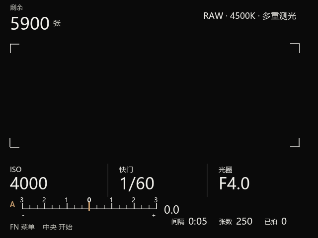
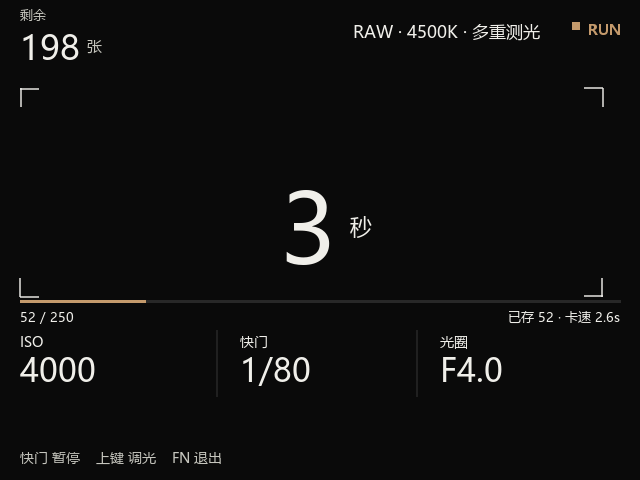
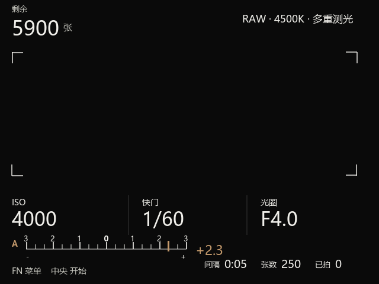
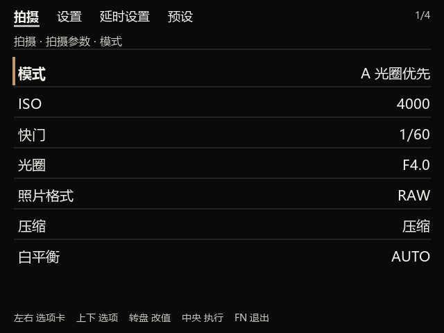
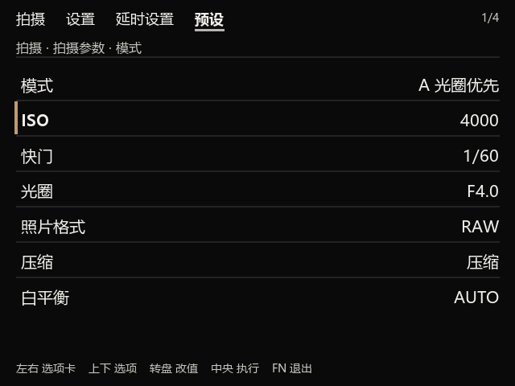

# Sony A7R2 Timelapse App

> 中文名：索尼 A7R2 延时摄影 APP ｜ 索尼 ILCE-7RM2 机内延时摄影应用


---

## 1. 软件介绍

**延时摄影**是一只跑在索尼 ILCE-7RM2（A7R II）相机内部的 Android 应用：装上之后，不用手机、不用外接定时器，
直接在机身屏幕上设好间隔与张数，按一次快门就自动一张张拍下去。

| 项目 | 内容 |
| --- | --- |
| 版本 | **v5.5**（versionCode 95） |
| 包名 | `com.shenwenjun.a7r2app` |
| 运行环境 | ILCE-7RM2（A7R II），固件 4.01，Android 4.1.2 / SDK 16 |
| 屏幕 | 640×480（61.2 mm 宽，density 1.5 → 427×320 dp） |
| APK | 约 175 KB，v1 签名（Android 4.1 不认 v2） |

**核心功能**

- **间隔拍摄**：时 / 分 / 秒设定（5 秒 – 24:59:59），张数 1–9999，绝对时间调度，来不及则跳格并记日志
- **参数面板（四选项卡）**：拍摄（模式 / ISO / 快门 / 光圈 / 照片格式 / 压缩 / 白平衡）、设置（对焦 / 测光 / 静音 / 防抖）、延时设置、预设
- **4 组预设**：间隔 + 张数 + 使用场景，转盘切槽位、中央键保存/载入，C2 一键循环到下一个非空预设
- **曝光标尺**：±3 EV，每 EV 标注数字，指针 + 数字读数（`+0.7` / `-1.0`）
- **拍摄中界面**：整秒倒计时、RUN 指示灯、黄铜进度线、剩余与已存张数
- **硬件键**：FN 菜单、C1 日志快照、C2 切预设、上键调暗屏幕、快门/删除键停止
- **写卡校验**：所有参数经 `CameraEx.createParametersModifier()` 写入并回读校验，相机重开后自动重写

**已知限制**

- 张与张之间预览会短暂黑 0.1–0.2 秒（相机重开的固有行为，无法消除）
- 不提供取景冻结 / 放大对焦 / 机身回放：相机不下发预览帧给 Java
- 自动检视请在相机菜单里手动关闭（App 读不到也写不了该设置）
- 装 APK、读卡都要求 **MTP 模式 + 管理员权限**；电脑遥控模式占用厂商接口，安装会失败

---

## 2. 安装方式

装完相机重启一次 → 应用程序列表里出现「延时摄影」。

### 图形化安装程序（推荐）

双击 `installer/` 编译出的 **索尼延时摄影安装程序.exe**：程序自动检测相机是否连接、是否处于 MTP 模式，
状态灯变绿后点「开始安装」→ 完成弹窗。APK 已内嵌在 exe 里，不需要另外找文件。

```bash
# 自行编译安装程序（Windows 自带 C# 编译器，无第三方依赖）
cd installer
C:\Windows\Microsoft.NET\Framework64\v4.0.30319\csc.exe /target:winexe /platform:anycpu /optimize+ ^
  /codepage:65001 /win32manifest:app.manifest /resource:..\dist\延时摄影-v5.5\延时摄影-v5.5.apk,APK ^
  /out:索尼延时摄影安装程序.exe Program.cs
```


---

## 3. 设计手册

完整的 12 页设计手册，包含设计目标与约束、信息架构、交互设计、视觉规范、预览界面栅格、数据与持久化、
技术取舍、版本演进与验收清单：

- 📘 [延时摄影-V5.5-设计手册.pdf](dist/延时摄影-V5.5-设计手册.pdf) —— 排版成品，适合直接阅读
- 📝 [延时摄影-V5.5-设计手册.docx](dist/延时摄影-V5.5-设计手册.docx) —— 可编辑源文件

其中关键的「预览界面栅格」把 640×480 上每个元素的位置与字号都写成数值表，可直接对照 `HudView.java` 实现核对。

---

## 4. UI 设计图

界面按实现坐标 1:1 重绘（640×480，黄铜 `#C49A6C` / 暖白 `#F0EFEA` / 次文字 `#C6C6BE` / 弱文字 `#93938B` / 底 `#0A0A0A`）。

| 预览 · 待机 | 预览 · 拍摄中 | 预览 · 曝光补偿 |
| --- | --- | --- |
|  |  |  |

| 菜单 · 拍摄 | 菜单 · 预设 |
| --- | --- |
|  |  |

**应用图标**（城市延时插画，512 / 192 / 144 用完整版，96 / 72 / 48 用简化版）

 

更多早期设计稿与交互原型：`docs/ui-v39-1.png`、`docs/ui-v39-2.png`、`docs/screen-01..07.png`，
可交互的网页原型见 `docs/ui-preview.html`（双击打开，`F` 切换预览/菜单）。

---

## 5. 设计文档

| 文档 | 内容 |
| --- | --- |
| [01-软件使用介绍.md](01-软件使用介绍.md) | 功能一览、按键说明、菜单操作流程、参数含义与取值范围 |
| [02-设计思路理念.md](02-设计思路理念.md) | 设计原则、去 AI 味的五条规则、信息分层、为什么不用圆角/阴影/填充块 |
| [03-信息架构.md](03-信息架构.md) | 四个选项卡的项目清单、动态列表规则、预设文件结构、数据存放位置 |
| [04-交互设计.md](04-交互设计.md) | 按键分工、菜单状态机、曝光标尺的 ±3 EV 与对齐算法、提示语规范 |
| [05-技术取舍.md](05-技术取舍.md) | HAL 限制（每张必须重开相机、预览帧不下发）、文件系统坑、字体三方案、验证三层 |

推荐阅读顺序：**01 上手 → 02 理解取舍 → 03/04 看结构与交互 → 05 看技术细节 → 设计手册查规范数值**。

---

## 仓库结构

```
.
├─ A7R2App/                 机内应用源码（Java + 手写 Canvas UI，无第三方库）
│   ├─ src/com/shenwenjun/a7r2app/   MainActivity / MenuView / HudView / Ui / CameraController / CameraSettings …
│   ├─ res/                 布局、字符串、五档密度图标、内置字体子集
│   ├─ build.cmd            构建脚本
│   └─ libs/sony-stubs.jar  索尼 CameraEx 等 API 的编译期桩
├─ installer/               图形化安装程序源码（C# WinForms，单文件 Program.cs）
├─ tools/                   构建校验、菜单审计、日志读取、设计稿渲染、打包脚本
├─ docs/                    界面截图、网页原型、早期设计稿
├─ dist/                    v5.5 发布物（APK / 设计手册 / 界面图 / 真机点测清单）
├─ toolchain/               便携 JDK 8 + Android SDK + Python
├─ pmca-re/                 PMCA-RE（把 APK 装进相机）
└─ 1-编译APK.cmd … 5-打开UI原型.cmd   双击即可用的脚本入口
```

## 版本记录

| 版本 | 要点 |
| --- | --- |
| v5.5 | 移除启动自检截图；图标定稿（城市延时） |
| v5.4 | 应用图标（五档密度，双版本绘制） |
| v5.3 | 曝光标尺 ±3 EV 带数字刻度；倒计时取整秒；去掉「下一张」 |
| v5.0 | 曝光补偿数字读数（修正 evStep 被截断为 0 的 bug） |
| v4.9 | 提亮文字对比度、字号整体放大（MID `#C6C6BE` / DIM `#93938B`） |
| v4.0 | 界面按设计稿重写：单一黄铜强调色、四角刻线、栅格化排布 |

---

开发者：Shenwenjun
